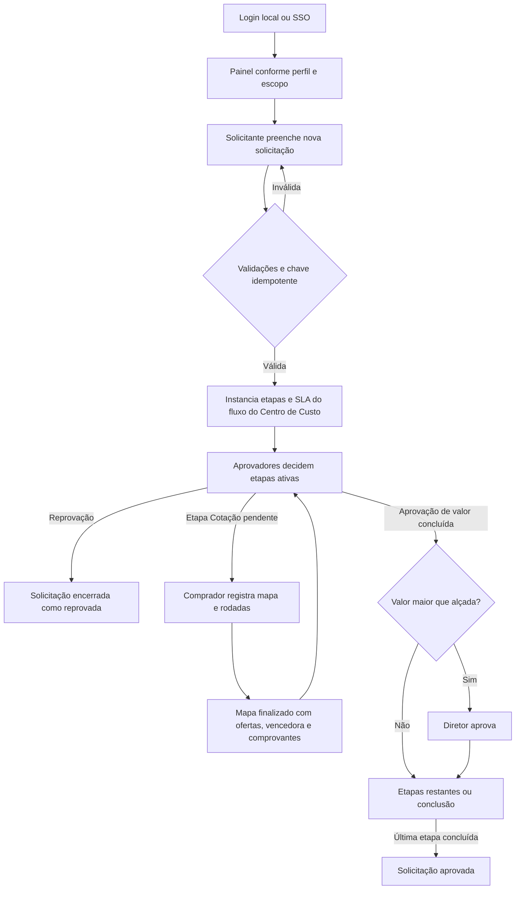

# Fluxos de ações do sistema

Este documento descreve como as ações disponíveis atualmente percorrem a aplicação. As etapas marcadas como **implementadas** correspondem às rotas existentes; ações descritas apenas nos requisitos, mas sem tela ou endpoint, estão listadas no final como pendentes.

## 1. Visão geral

As etapas efetivamente criadas para cada solicitação vêm da versão vigente do fluxo do Centro de Custo. As instâncias guardam snapshots dos aprovadores e das regras para preservar a configuração aplicada quando a solicitação foi aberta.

## 2. Identidade, entrada e saída

### Login local — implementado

1. A pessoa abre `index.php` e informa matrícula e senha.
2. O sistema procura uma conta ativa e valida o hash com `password_verify()`.
3. Se as credenciais forem válidas, regenera o ID da sessão, grava o usuário e o método local na sessão e redireciona para `painel.php`.
4. Credenciais inválidas mantêm a pessoa na tela de entrada e registram tentativa negada. Falha técnica é registrada como erro do sistema.
5. Se a pessoa já estiver autenticada, `index.php` redireciona diretamente ao painel.

### Login pelo Portal SSO — implementado, depende da configuração do ambiente

1. O Portal chama `sso.php` por HTTPS com um token JWT assinado e de uso único.
2. O endpoint valida método, HTTPS, audiência, assinatura, validade e claims conforme `docs/integracao-sso.md`.
3. O `jti` é gravado em `sso_tokens_utilizados`; a chave primária impede replay do mesmo token.
4. O usuário precisa existir e estar ativo localmente. O SSO não cria usuários nem perfis.
5. O sistema registra auditoria, regenera a sessão e redireciona para `painel.php`. Token inválido, repetido, usuário inexistente ou indisponibilidade do banco resulta em erro e registro correspondente.
6. `scripts/limpar_sso_tokens.php` remove tokens expirados há mais de um dia. Deve ser executado pela rotina operacional via CLI.

### Logout — implementado

`logout.php` invalida os dados da sessão e o cookie, registra a saída e redireciona para `index.php`. Não há logout único no Portal.

### Recuperação de senha — implementada

1. Na tela de login, a pessoa informa o e-mail associado a uma conta ativa.
2. A resposta não confirma se o endereço existe. Para reduzir abuso, cada conta pode solicitar até três links por hora.
3. Para uma conta elegível, o sistema gera um token aleatório, armazena somente seu SHA-256 e envia um link com validade de uma hora pelo SMTP autenticado. Configure `APP_BASE_URL` e as variáveis `MAIL_HOST`, `MAIL_PORT`, `MAIL_USERNAME`, `MAIL_PASSWORD`, `MAIL_ENCRYPTION`, `MAIL_FROM_NAME` e `MAIL_FROM_ADDRESS`; em produção, publique em HTTPS.
4. O link abre `recuperar_senha.php`, onde a pessoa informa e confirma uma senha com pelo menos 12 caracteres e no máximo 72 bytes. O servidor revalida o token dentro de uma transação, altera o hash da senha com `password_hash()` e invalida todos os links ainda pendentes da conta.
5. Token inválido, expirado ou usado novamente não altera a senha. A conta não é autenticada automaticamente após a redefinição.

## 3. Painel e visibilidade por perfil

1. `painel.php` exige uma sessão local e carrega somente perfis ativos e dentro da validade.
2. Cada pessoa possui um único vínculo de perfil/escopo. Quando aplicável, as abas do painel alternam entre a visão desse perfil e a fila de aprovações pendentes; a função de aprovador decorre das etapas atribuídas, não de um segundo perfil.
3. **Solicitante:** vê suas próprias solicitações e pode iniciar uma nova quando tem o perfil correspondente.
4. **Comprador:** vê solicitações já atribuídas a si e solicitações em aprovação dentro do escopo de Centro de Custo/unidade do perfil. Pode revisar e incluir alçadas na etapa vigente antes da primeira decisão. A gestão de cotação continua restrita às solicitações na etapa de cotação.
5. **Aprovador:** vê na fila as etapas pendentes das quais é responsável. Em regra E, a fila respeita a ordem dos aprovadores; em regra OU, qualquer aprovador ainda sem decisão pode agir.
6. **Gestor:** o painel lista contratos no seu escopo organizacional. A página de solicitação também pode conduzir ao contrato associado quando o gestor tem autorização para vê-lo.
7. **Diretor:** consulta solicitações e contratos na visão organizacional.
8. **Administrador:** o painel reúne as visões de dashboard, solicitações da organização, próprias solicitações, contratos, aprovações pendentes e histórico, sem repetir links. Pode consultar detalhes de solicitações e contratos; continua sem executar ações reservadas a outros perfis, exceto decisões de aprovação para as quais esteja designado.
9. Gestor e Diretor podem consultar no painel as decisões de aprovação que registraram.

`solicitacao_ver.php` verifica acesso novamente, independentemente do painel. O solicitante vê a própria SC; comprador vê as solicitações em aprovação no seu escopo e as atribuídas a si; Diretor e Administrador têm visão ampla; aprovadores designados consultam o detalhe para decidir. `contrato_ver.php` permite leitura ao Administrador e ao Diretor, ou ao Gestor dentro do escopo.

## 4. Criar e acompanhar uma solicitação

### Preenchimento e envio — implementado

1. O Solicitante abre **Nova solicitação** em `solicitacao_nova.php`.
2. Seleciona Centro de Custo, Categoria e Produto ativo sincronizados do cadastro local do OMIE; a lista de produtos é filtrada pela categoria.
3. Informa quantidade positiva, prazo estimado e justificativa. Anexos técnicos são opcionais para qualquer categoria.
4. O formulário recebe token CSRF e chave idempotente aleatória.
5. `solicitacao_criar.php` valida novamente a sessão, a chave, o Centro de Custo, a Categoria, o Produto, a correspondência entre produto e categoria, quantidade, prazo e justificativa.
6. O sistema encontra a versão vigente do fluxo para o Centro de Custo e instancia somente as etapas ativas, com aprovadores e regras copiados para snapshots. A primeira etapa fica pendente; as seguintes aguardam. Inicia também o SLA da primeira etapa, se configurado.
7. Cabeçalho, item e etapas são gravados em uma transação. Em sucesso, o sistema registra a ação e redireciona para `solicitacao_ver.php`.
8. Se os dados falharem na validação ou não houver fluxo/aprovadores válidos, o envio é interrompido sem confirmar a solicitação.

### Proteção contra reenvio — implementado

- Reenvio com a mesma chave e o mesmo hash de conteúdo redireciona à solicitação já criada; não cria outra.
- Reuso da chave com conteúdo diferente retorna conflito HTTP 409 e pede um novo formulário.
- A chave única no banco e a transação são a garantia de idempotência; desabilitar o botão no navegador é apenas uma ajuda visual.

### Revisar alçadas — Comprador

1. O Comprador abre no painel uma solicitação em aprovação dentro de seu escopo de Centro de Custo/unidade.
2. Antes da primeira decisão da etapa vigente, pode acrescentar grupos de aprovação e/ou aprovadores individuais.
3. O sistema valida novamente o perfil e o escopo do Comprador, confirma que os aprovadores estão ativos e que os membros de grupos estão vigentes, e grava a alteração no snapshot da etapa e na auditoria, em uma transação.
4. Em regra **E**, os novos aprovadores são inseridos depois da hierarquia já configurada e devem aprovar na sequência. Em regra **OU**, todos participam do colegiado; a primeira aprovação conclui a etapa, e o painel e o detalhe mostram **Aprovado por [nome]** aos demais.
5. Depois que qualquer decisão é registrada, a inclusão de alçadas nessa etapa é bloqueada. A alteração não muda a configuração de solicitações futuras nem o fluxo associado ao Centro de Custo.

### Acompanhamento — implementado parcialmente

`solicitacao_ver.php` apresenta dados da SC, itens, situação e indicador de etapas ativo para aquele Centro de Custo, responsáveis, prazo e SLA. Exibe o comparativo das rodadas de cotação quando há mapas registrados. A integração com OMIE é apenas representada pelos campos/status preparados; a página não envia pedidos ao ERP.

## 5. Configuração do Administrador de Compras

`admin.php` exige o perfil ativo **Administrador**. Todas as alterações são POST protegidos por CSRF e retornam à tela por redirecionamento.

### Grupos e membros aprovadores — implementado

| Ação | Sequência | Resultado |
|---|---|---|
| Criar grupo | Informar nome e descrição e salvar. | Cria grupo ativo; nome duplicado é rejeitado. |
| Editar grupo | Abrir ações do grupo, alterar nome/descrição e salvar. | Atualiza os dados sem alterar a associação dos membros. |
| Adicionar membro | No modal, selecionar usuário ativo e adicionar. | Cria vínculo ativo e atribui a próxima posição hierárquica disponível; vínculo duplicado é rejeitado. |
| Alterar ordem | Editar a ordem do membro no modal e salvar. | Atualiza a sequência usada por etapas E. A ordem deve ser positiva; ao publicar um fluxo, o sistema rejeita membros ativos do mesmo grupo com posições repetidas. |
| Remover membro | Acionar remover no membro listado no modal. | Exclui o vínculo do grupo; não exclui a conta do usuário. |
| Dissolver grupo | Solicitar exclusão e confirmar no alerta. | Remove os vínculos e exclui o grupo, mas bloqueia se ele estiver referenciado em alguma regra de etapa. Usuários permanecem no sistema. |

O modal lista membros ativos e vigentes com suas ordens. Um grupo associado a uma trilha deve primeiro ser substituído na configuração daquela trilha antes de ser excluído.

### Calendários e feriados — implementado

| Ação | Sequência | Resultado |
|---|---|---|
| Criar calendário | Informar nome, fuso, dias da semana e início/fim da jornada. | Cria um calendário. A janela precisa ser válida e o fim posterior ao início. |
| Adicionar feriado | Selecionar calendário, data e descrição. | Registra feriado único por calendário/data. |
| Remover feriado | Acionar exclusão no calendário correspondente. | Remove somente o feriado selecionado. |

A interface atual não oferece edição nem exclusão de calendários. Sábados são úteis somente se estiverem selecionados no calendário. Feriados e dias não úteis afetam cálculos de SLA de acordo com a política da etapa.

### Publicar trilha por Centro de Custo — implementado

1. Selecionar um Centro de Custo ativo.
2. Marcar pelo menos uma etapa entre Solicitação, Mapa de Cotação, Aprovação de Valor e Pedido. Mapa de Cotação e Aprovação de Valor precisam estar ativos juntos.
3. Para cada etapa ativa, configurar tipo de responsável: grupo, usuário ou grupo e usuário; selecionar os responsáveis e o modo E/OU.
4. Para cada etapa, informar prazo, unidade horas/dias, regime corridos/úteis e as configurações de calendário/janela aceitas pela tela.
5. Opcionalmente, informar o limite de alçada do Diretor para aquele fluxo.
6. Salvar. O sistema valida responsáveis ativos, grupos com membros vigentes, ordens hierárquicas e política de prazo. Se válida, cria uma nova versão do fluxo, substitui o vínculo vigente do Centro de Custo e registra a alteração numa transação.
7. Solicitações já abertas mantêm os snapshots existentes; a nova trilha é consultada na abertura de solicitações posteriores.

## 6. Mapa de cotação — Comprador

### Acesso e atribuição

1. O Comprador abre no painel uma solicitação na etapa **Mapa de cotação** e dentro do seu escopo.
2. `mapa_cotacao.php` confere perfil, escopo, status, etapa e se a SC está livre ou já atribuída ao próprio comprador.
3. No primeiro POST, a solicitação sem comprador é assumida dentro da transação. Se outra pessoa já a assumiu, a ação falha e os dados não são gravados.

### Rodada e rascunho

1. Iniciar a cotação cria a primeira versão do mapa.
2. Em cada oferta, selecionar fornecedor ativo/candidato; informar valor unitário para cada item da solicitação, prazo de entrega em dias, condição de pagamento e frete CIF ou FOB.
3. **Salvar rascunho** grava as ofertas e os preços por item sem exigir ainda a evidência, mínimo de três fornecedores ou seleção de vencedora.
4. Para abrir outra rodada, salvar antes os dados da rodada atual e então acionar **Criar nova rodada**. A rodada aberta anterior passa a `substituido`; suas ofertas continuam no histórico. O fornecedor pode ser repetido em outra versão, mas só pode aparecer uma vez na mesma rodada.

### Finalização

1. Selecionar uma única oferta vencedora.
2. Anexar ao menos um comprovante por oferta. Tipos aceitos: PDF, JPG, PNG e EML; limite atual de 20 MB por arquivo. Arquivos ficam em `storage/private/quotes` e são entregues somente pela rota autorizada `anexo_baixar.php`.
3. Com menos de três fornecedores distintos na rodada, preencher a justificativa de fornecedor único/insuficiente.
4. Se a oferta vencedora tiver valor total maior que o menor total, preencher justificativa da escolha.
5. **Finalizar e enviar para aprovação** valida campos, ofertas, anexos, mínimo/exceção e vencedora. Se qualquer validação falhar, a transação é revertida e o mapa continua aberto.
6. No sucesso, o mapa fica `aguardando_aprovacao` e deixa de ser editável. O detalhe da SC passa a exibir o comparativo aos usuários autorizados.

Depois do envio, a tela atual não permite criar outra rodada ou reabrir o mapa. O workflow ainda não tem uma ação implementada de devolução para o Comprador.

## 7. Aprovar ou reprovar uma etapa

1. O usuário abre uma tarefa na fila de aprovação ou o detalhe da solicitação. O servidor confirma que ele está na lista de aprovadores do snapshot da etapa atual e que ainda não decidiu.
2. Em regra **E**, somente o próximo usuário na ordem pode decidir; após a aprovação dele, o seguinte passa a poder agir. A etapa avança quando todos os aprovadores requeridos aprovarem.
3. Em regra **OU**, qualquer aprovador listado pode aprovar e a primeira aprovação conclui a etapa; o histórico e o indicador visual mostram quem aprovou, inclusive para os demais membros do colegiado.
4. Antes de aprovar, `app/request_integrity.php` valida dados obrigatórios da SC. Nas etapas de cotação/valor/pedido/alçada, verifica ainda o estado do mapa, quantidade mínima ou justificativa, comprovantes, oferta vencedora e justificativa quando a vencedora não é a mais barata.
5. **Aprovar etapa** registra decisão, auditoria e log. Encerra o SLA da etapa e inicia a próxima etapa aguardando. O navegador é redirecionado ao painel.
6. Ao concluir **Aprovação de Valor**, o mapa vencedor é marcado aprovado e congelado.
7. Depois da última etapa padrão, o sistema compara o valor vencedor em BRL com o limite configurado. Se for estritamente maior, instancia a etapa final `diretor_alcada` para usuários ativos com perfil Diretor; qualquer um deles pode aprovar. Se o limite não for ultrapassado, a solicitação é marcada aprovada.
8. **Reprovar solicitação** exige justificativa. A etapa fica reprovada, o SLA é encerrado e a solicitação termina com status `encerrado_reprovado`; não avança para outras etapas.
9. Aprovação sem os dados exigidos retorna erro, não grava a decisão e mantém a etapa pendente. A reprovação continua disponível, pois encerra o fluxo em vez de encaminhar dados à próxima etapa.

O workflow atual implementa aprovar e reprovar. Devolver para correção, solicitar informação/diligência e retomar a etapa não têm ação operacional implementada.

## 8. Comprovantes, contratos e consultas

- Na comparação do mapa em `solicitacao_ver.php`, usuários que podem ver a solicitação consultam valores, condições, vencedora e links dos comprovantes.
- `anexo_baixar.php` verifica o usuário solicitante, Diretor, Administrador, Comprador atribuído ou no escopo da cotação, ou aprovador presente no snapshot de uma etapa. Sem autorização, responde HTTP 403; arquivo ausente/inválido responde HTTP 404.
- Gestor dentro do escopo e Diretor podem consultar contratos em `contrato_ver.php`. Não há ações de criar ou editar contratos nessa tela.
- O indicador de etapas omite etapas inativas no fluxo instanciado e mostra concluídas, atual e futuras. O SLA exibe percentual, limite/vencimento e sinaliza o limite atingido.

## 9. Logs e ações de manutenção

`app/system_log.php` registra resultado, usuário, entidade/ID, IP, horário e contexto sem incluir senhas, tokens ou o conteúdo livre completo dos formulários. Há eventos de login/logout, criação e reenvio de SC, inclusão de alçadas, decisões, configuração de fluxo, gestão de grupo/calendário/feriado, mapa/rodada, download de comprovante e falhas técnicas. Erros tratados e alguns erros fatais também são encaminhados ao log.

`scripts/limpar_sso_tokens.php` é uma ação de manutenção somente CLI. Remove tokens anti-replay expirados há mais de um dia e registra a quantidade removida. Não deve ser executado por URL web.

O perfil Administrador consulta os registros de `log_sistema` em **Administração > Logs do sistema**. A grade usa paginação e busca server-side, com seleção de 10, 25, 50 ou 100 linhas por página. A rota `admin_logs.php` repete a autorização do perfil antes de retornar qualquer registro.

## 10. Ações ainda não disponíveis

Os itens abaixo fazem parte do processo futuro ou da análise de requisitos, mas não têm hoje uma ação correspondente completa no sistema:

- Criar/editar contas e conceder perfis pela interface; os usuários e perfis são mantidos fora destas telas.
- Editar os dados da solicitação ou cancelar o fluxo após o envio. A inclusão de alçadas pelo Comprador na etapa vigente está disponível antes da primeira decisão.
- Devolver uma SC ao Solicitante para correção, abrir diligência/pedido de informação e retomar a etapa pausada.
- Retornar mapa submetido ao Comprador para nova rodada ou reabertura.
- Criar/editar contrato a partir da conclusão da compra.
- Enviar pedido, fornecedor ou cadastro para o OMIE, receber callback/webhook, tentar novamente integração ou homologar fornecedor candidato. Os campos de estado/ID OMIE são apenas preparados.
- Enviar notificações, alertas ou escalonamentos de SLA.
- Editar ou excluir calendários; o histórico/versionamento de alterações administrativas ainda é limitado.

Não interpretar o fluxo desenhado na análise como funcionalidade pronta: para esta lista, a disponibilidade é determinada pelas páginas, endpoints e ações descritas nas seções anteriores.
